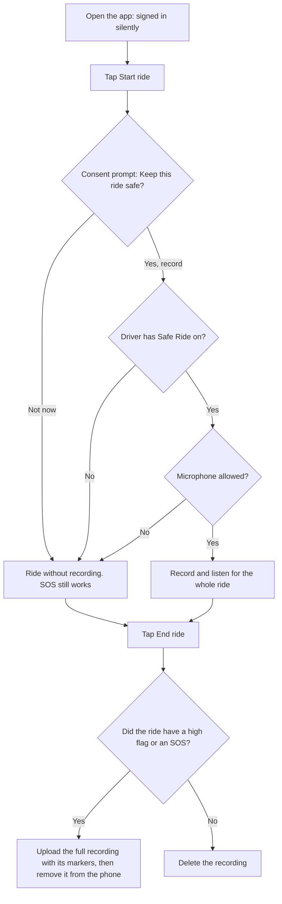
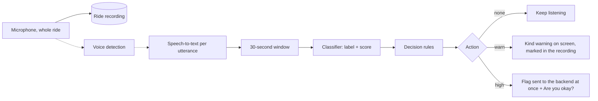

# GoSafe mobile app: technical and logic guide

The mobile app is the core of GoSafe. It runs on the consumer's phone. During a ride it records, turns speech into text, judges the conversation and responds, all on the phone. The backend only receives what the phone sends: flags during the ride, and the full recording after a serious one.

This guide describes the app as it is built today. The product decisions behind it are in [contracts/ARCHITECTURE.md](../contracts/ARCHITECTURE.md), section "On-device listening".

## Status

| Part | State |
|---|---|
| Start ride, consent prompt, no login (anonymous sign-in) | Built |
| Microphone recording for the whole ride | Built (`record` package, AAC on Android, WAV in the browser preview) |
| Decision engine (30 s window, classifier, rules) | Built and tested |
| Warning, high flag sent at once, "Are you okay?", SOS, "I feel unsafe" | Built and tested |
| Full recording uploaded after a high or SOS ride, deleted otherwise | Built and tested |
| Answering backend check-ins | Built (reads Firestore directly) |
| Voice detection, speech-to-text | **Temporary**: a scripted conversation stands in |
| Classifier | **Temporary**: an Indonesian keyword filter stands in for IndoBERT |
| Recording in the background | Built: a microphone foreground service ("GoSafe is keeping this ride safe") keeps recording and listening with the screen locked. Tested on the Android emulator |
| Alarm on a high flag, alert for check-ins | Built: a high flag sounds the phone's alarm (alarm sound, vibration, repeating) until someone answers "Are you okay?"; a backend check-in shows a normal alert. No Firebase needed: the service keeps the app alive during the ride |
| Encryption on the phone | Built: the recording is AES-256-GCM encrypted with an Android Keystore key the moment recording stops, and decrypted only to upload |
| Push when the app is fully closed | Not built: needs FCM and a real Firebase project. During a ride the service keeps the app open, so it isn't needed then |

## How one ride works



- **No login.** Each install signs in anonymously in the background, so the backend still knows whose ride and report it is. In the real product the GoJek app's own login replaces this.
- **One flow, no role choice.** The app is the consumer's. Only the consumer is asked for consent.
- **The driver decided earlier.** Drivers turn recording on or off in their own settings. Turning it on gives them the **Safe Ride badge**, which the consumer sees during the ride ("Your driver has Safe Ride on"). If the driver left it off, nothing is recorded.
- **No location.** The app never asks for location permission. A ride is identified by the GoJek order ID; for the demo the backend generates one.

## The listening pipeline



The microphone really records. Voice detection and speech-to-text (the dotted part) are still in the making, so `mock_listener.dart` stands in: it plays a scripted Indonesian conversation, one line every 3 seconds. Everything from the window onwards is the real logic.

### Step 1: the 30-second window

Every finished utterance is added to a list with the time it was heard. Lines older than 30 seconds are dropped. The classifier always judges the whole window, so a remark is read in context. When the phone sends a flag, this window is the evidence; each line's `start` and `end` are seconds from the first line in the window.

### Step 2: the classifier (temporary keyword filter)

`KeywordClassifier` looks for Indonesian phrases, including Jakarta slang, in three groups:

| Label | Example phrases |
|---|---|
| `threat` | bunuh, pukul, hajar, pisau, culik, "diem aja", "jangan banyak tanya", "tahu rumah", "jangan lapor" |
| `sexual_harassment` | "cantik banget", seksi, pegang, cium, raba, "ke hotel", "mampir ke tempat", "tempat saya", "buka baju" |
| `uncomfortable` | "tinggal sendiri", sendirian, "punya pacar", "rumahnya di mana", "minta nomor", "umur berapa", sayang |

How it scores the window:

- It counts every matched **phrase** in the window, per label. Two phrases in one sentence count as two.
- The window gets the most severe label that has any match, in the order threat, sexual harassment, uncomfortable. No match means `normal`.
- Score = 0.5 + 0.15 × (number of phrases for that label), capped at 0.95. A `normal` window scores 0.5.
- Each line is marked `flagged` if it contains any phrase. The dashboard highlights flagged lines.

### Step 3: the decision rules

`SafetyEngine` turns each verdict into one action. It checks in this order:

1. **Already flagged high on this ride?** Then do nothing more. A person at customer service has the case. Warnings stop too.
2. **High:** the label is `threat` or `sexual_harassment` and the score is at least **0.8**.
3. **Warning:** any label other than `normal`, a score of at least **0.6**, and no warning in the last **10 minutes**.
4. Otherwise, nothing.

| Setting | Value today | Who sets the real value |
|---|---|---|
| Warning threshold | 0.6 | Modelling team, from their test set |
| High threshold | 0.8 | Modelling team, from their test set |
| Window | 30 s | Fixed by the design |
| Warning cooldown | 10 min | Fixed by the design |

What that means with the keyword filter:

| Heard within 30 s | Score | Result |
|---|---|---|
| Ordinary talk | 0.50 | Nothing |
| One uncomfortable phrase ("Udah punya pacar belum?") | 0.65 | Warning |
| One harassment phrase | 0.65 | Warning only |
| Two harassment phrases ("Cantik banget sih, nanti mampir ke tempat saya") | 0.80 | High |
| One threat phrase | 0.65 | Warning |
| Two threat phrases | 0.80 | High |

### The demo conversation, step by step

| Time | Line | What happens |
|---|---|---|
| 3 s | Selamat sore Mbak, sesuai aplikasi ya, ke Senayan. | Nothing |
| 6 s | Iya Pak, lewat Sudirman aja. | Nothing |
| 9 s | Mbak kerja di mana? Udah punya pacar belum? | **Warning** (uncomfortable, 0.65), marked |
| 12 s | Hmm, Pak, fokus nyetir aja ya. | Nothing |
| 15 s | Tinggal sendiri ya? Rumahnya di mana? | Nothing (warning cooldown) |
| 18 s | Cantik banget sih, nanti mampir ke tempat saya dulu. | **High** (sexual harassment, 0.80): flag sent, "Are you okay?" |
| 21 s | Pak, saya mau turun di depan aja. | Nothing (already flagged) |

At "End ride", this ride had a high flag, so the full recording uploads with two markers: the warning at 9 s and the high flag at 18 s.

## What the person sees

Every message is short and caring, never alarming. All the wording lives in one place, `SafetyText` in `lib/features/safety/are_you_ok.dart`.

| Moment | Message | Buttons |
|---|---|---|
| Start ride | **Keep this ride safe?** "We'd like to record audio during this ride. It's only reviewed if something seems wrong, and it's deleted after 7 days." | Not now / Yes, record |
| Warning | "Hey, this conversation seems to be getting uncomfortable. Let's keep it kind. If you feel unsafe, we're right here." | I'm fine / Report |
| High flag | **Are you okay?** "Something didn't sound right, so we've let our safety team know. Tap if you need help." | I'm okay / I need help |
| "I need help" or SOS | "We're on it. Our safety team will contact you right away." | |
| "I'm okay" | "Glad you're okay. We're still here if anything changes." | |
| Report or "I feel unsafe" | "Thanks for telling us. Our safety team will look into it." | |
| End of a flagged ride | "Ride ended. The recording was sent to our safety team." | |
| End of any other ride | "Ride ended. Nothing needed checking, so the recording was deleted." | |

These messages appear in a card at the **top** of the screen, never as a pop-up at the bottom: nothing may cover the SOS button. SOS, "I feel unsafe" and "End ride" stay pinned at the bottom, and everything above them scrolls.

## What the phone sends, and when

**During the ride, at once.** Only what needs a person now:

| `trigger` | Sent when | What the backend does |
|---|---|---|
| `auto` | The engine reached "high" | Escalates straight away: the highest priority for customer service |
| `sos` | SOS button, or "I need help" | Escalates if the label is harmful or there's no label; otherwise asks "Are you okay?" through a check-in |
| `manual_unsafe` | "I feel unsafe", or Report on a warning | Escalates if the label is harmful; otherwise a check-in |

Each one is `POST /incidents`, then `POST /incidents/{id}/finalize`, with the phone's evidence:

```json
{
  "tripId": "GR-8FBA186A",
  "trigger": "auto",
  "windowStart": "2026-11-26T08:59:12Z",
  "windowEnd": "2026-11-26T08:59:34Z",
  "deviceTranscript": [
    {"start": 6, "end": 10, "text": "Mbak kerja di mana? Udah punya pacar belum?"},
    {"start": 15, "end": 19, "text": "Cantik banget sih, nanti mampir ke tempat saya dulu."}
  ],
  "deviceLabel": "sexual_harassment",
  "deviceScore": 0.8
}
```

Warnings are **not** sent during the ride. They stay on the phone as markers.

**After the ride, only if it had a high flag or an SOS.** The full recording and every moment to check:

```json
POST /trips/GR-8FBA186A/recording
{
  "durationSec": 25.0,
  "contentType": "audio/mp4",
  "markers": [
    {"at": 9.0, "kind": "warning", "label": "uncomfortable", "score": 0.65, "text": "Mbak kerja di mana? Udah punya pacar belum?"},
    {"at": 18.0, "kind": "high", "label": "sexual_harassment", "score": 0.8, "text": "Cantik banget sih, nanti mampir ke tempat saya dulu."}
  ]
}
```

The backend answers with an upload URL and method. The phone sends the audio there, then calls `POST /trips/{id}/recording/done`. The backend refuses a recording with no `high` or `sos` marker, so this privacy rule also holds if the app has a bug. Agents play it with `GET /trips/{id}/recording-url`, which is logged.

Other calls: `POST /trips` (with `riderConsent`), `POST /trips/{id}/end` and `POST /checkins/{id}/reply`. The app reads two things straight from Firestore: the ride's consents, and its own unanswered check-ins.

## Privacy rules the code follows

- Nothing is recorded unless the consumer said yes **and** the driver has Safe Ride on.
- No location: no permission, no GPS, no route.
- During the ride only high flags and button presses leave the phone.
- The full recording leaves the phone only after a ride with a high flag or SOS. Otherwise it's deleted.
- The recording lives in the app's private folder, encrypted once the ride ends (the key never leaves the Android Keystore). The next ride start deletes the last ride's file.
- While recording, Android always shows the "GoSafe is keeping this ride safe" notification: listening is never hidden.
- A person at customer service reviews every case. The app never warns, suspends or bans a driver on its record.

## Code map

| File | Job |
|---|---|
| `lib/main.dart` | Starts Firebase (pointed at the emulators), signs in anonymously (fresh each launch in emulator mode), builds the ride screen with the real API, microphone and Firestore |
| `lib/theme.dart` | Design tokens and the app theme from [contracts/DESIGN.md](../contracts/DESIGN.md) (`GoSafeColors`, `GoSafeType`, `goSafeTheme`) |
| `lib/features/trip/trip_screen.dart` | The ride: start, consent, recording, listening, every response, and the upload decision at the end |
| `lib/features/safety/are_you_ok.dart` | All the wording (`SafetyText`), the consent prompt and the "Are you okay?" dialog |
| `lib/engine/safety_engine.dart` | The 30-second window, the decision rules, and `Marker` |
| `lib/engine/classifier.dart` | The `Classifier` interface and the temporary keyword filter |
| `lib/services/recorder.dart` | Microphone recording for the whole ride (`TripRecorder`: start, stop, discard), encrypted at stop |
| `lib/services/ride.dart` | The channel to the Android side: listening service, alerts, encryption |
| `android/app/src/main/kotlin/com/gosafe/gosafe/` | `MainActivity` (the channel), `RideService` (foreground service and `Alerts` notification channels), `Vault` (Keystore AES-GCM) |
| `lib/services/api.dart` | Calls to the backend, including the recording upload |
| `lib/services/mock_listener.dart` | The scripted conversation standing in for voice detection and speech-to-text |

## Swapping in the real models

Two interfaces keep the stand-ins replaceable without touching the screen or the engine:

- **Speech:** `TripScreen.listen` is a `Stream<String> Function()`, one finished utterance per item. Replace `scriptedListener` with a sherpa_onnx listener that runs Silero voice detection, then Whisper on each utterance. It can read the same microphone audio the recorder captures.
- **Classifier:** `Classifier.classify(List<String> lines)` returns a label, a score and per-line flags. Replace `KeywordClassifier` with IndoBERT in ONNX Runtime, plus a Dart port of its tokenizer.

Then set the real thresholds in `SafetyEngine`.

## Tests

`flutter test` runs 16 tests with no backend needed.

| File | Covers |
|---|---|
| `test/engine_test.dart` | Classifier labels, flags and scores. Engine: ordinary talk, warning and cooldown, high once per ride, the 30-second window, a threat below the high threshold |
| `test/trip_screen_test.dart` | Consent yes starts recording and listening; "Not now" records nothing and SOS works; no recording if the driver lacks Safe Ride or the microphone is denied; the warning sends nothing; a high flag is sent at once and "I need help" sends SOS; a flagged ride uploads its recording with markers; a warnings-only ride deletes it; a backend check-in is answered once |

## Running it

Start the emulators, seed data and backend as described in the root [CLAUDE.md](../CLAUDE.md), under "Run everything locally". Then, from `mobile/`:

| Target | Command | Microphone |
|---|---|---|
| Chrome | `flutter run -d chrome` | Works; Chrome asks for permission |
| Android emulator | `flutter run` (reaches this Mac at `10.0.2.2`) | Uses the Mac's microphone |
| Real phone, same Wi-Fi | Run `scripts/demo.sh` from the repo root, then the `flutter run` line it prints | Works |

Claude Code's browser pane blocks microphones, so there the app takes the "not recording" path.
