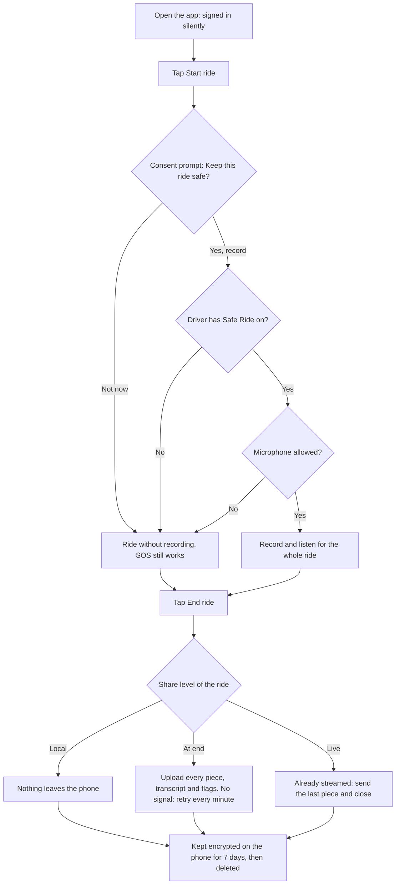

# GoSafe mobile app: technical and logic guide

The mobile app is the core of GoSafe. It runs on the consumer's phone. During a ride it records, turns speech into text, judges the conversation and responds, all on the phone. The backend only receives what the phone sends: flags during the ride, and the full recording after a serious one.

This guide describes the app as it is built today. The product decisions behind it are in [contracts/ARCHITECTURE.md](../contracts/ARCHITECTURE.md), section "On-device listening".

## Status

| Part | State |
|---|---|
| Start ride, consent prompt, no login (anonymous sign-in) | Built |
| Microphone recording for the whole ride | Built (`record` package, AAC on Android, WAV in the browser preview) |
| Decision engine (15 s window, classifier, rules) | Built and tested |
| Warning, high flag sent at once, "Are you okay?", SOS, Report driver / passenger | Built and tested |
| Rider and driver on the same app (switch on the home screen, demo only) | Built and tested (driver mode not yet run on a device) |
| Share levels: local, at end, live (see "What leaves the phone, and when") | Built and tested; Live tested on the Android emulator |
| Every ride kept on the phone for 7 days, encrypted, in 30-second pieces (10-second when Live) | Built and tested |
| SOS with no signal: offers 112, retries until sent | Built and tested |
| Voice detection, speech-to-text | **Temporary**: a scripted conversation stands in |
| Classifier | **Temporary**: an Indonesian keyword filter stands in for IndoBERT |
| Recording in the background | Built: a microphone foreground service ("GoSafe is keeping this ride safe") keeps recording and listening with the screen locked. Tested on the Android emulator |
| High flag check, quiet first | Built: vibration every 10 s; Live at 60 s with no answer; loud alarm and "shout TOLONG" at 120 s. No Firebase needed: the service keeps the app alive during the ride. Tested on the Android emulator |
| Encryption on the phone | Built: every 30-second piece and the ride's details are AES-256-GCM encrypted with an Android Keystore key as they're saved, and decrypted only to upload |
| Push when the app is fully closed | Not built: needs FCM and a real Firebase project. During a ride the service keeps the app open, so it isn't needed then |

## How one ride works



- **No login.** Each install signs in anonymously in the background, so the backend still knows whose ride and report it is. In the real product the GoJek app's own login replaces this.
- **Rider or driver.** A switch on the home screen picks whose phone this is (demo only; in production these are two apps). The rider is asked for consent; the driver isn't, because their **Safe Ride** switch is their consent. The driver's phone joins the rider's ride (`POST /trips` with `role: driver`), so the rider must start first.
- **The driver decided earlier.** Drivers turn recording on or off in their own settings. Turning it on gives them the **Safe Ride badge**, which the consumer sees during the ride ("Your driver has Safe Ride on"). If the driver left it off, nothing is recorded.
- **No location.** The app never asks for location permission. A ride is identified by the GoJek order ID; for the demo the backend generates one.

## What leaves the phone, and when

Each ride has a **share level** that only goes up: **local → at end → live**.

| What happened | You answer | Level | What leaves the phone |
|---|---|---|---|
| Nothing | | Local | Nothing. Kept encrypted on the phone 7 days |
| Warning (medium), 1st on the ride | "I'm fine", or ignore it | Local | Nothing. The flag is kept on the phone with the ride |
| Warning, 2nd on the ride | (a firmer warning) | At end | When the ride ends: every audio piece, the transcript and every flag. No case yet |
| Warning, 3rd on the ride | | At end | Counts as a high flag (below) |
| Warning, or any time | **Report driver** (or passenger) → "I'm safe for now" | At end | The report goes now (`manual_unsafe`). When the ride ends: every audio piece, the transcript and every flag |
| Warning, or any time | **Report driver** → **Yes, get help** | Live | An SOS, and Live (below) |
| High flag | "I'm okay" | At end | The flag went to an agent at once. When the ride ends: the whole ride |
| High flag | "I need help" | Live | An SOS, and Live |
| High flag | no answer | Live at 60 s | See the timeline below |
| High flag, 2nd on the ride | "Are you still okay?" | Live | The flag joins the same case at once, and the ride goes Live |
| High flag, 3rd on the ride | (no question) | Live | An SOS on the person's behalf, and Live |
| Any time | SOS button, or a shout for help | Live | An SOS, and Live |
| Any time | The safe phrase | Live | A high flag (`auto`) at once, **silently** (no question, no alarm), and Live at once. It counts on the high ladder: as the 3rd high flag it is an SOS |

**Live** means: at once, every audio piece so far, the transcript and the flags; then a new 10-second piece and the new lines every 10 seconds until the ride ends. The case is marked **LIVE** at the top of the agents' queue, and the agent can listen while the ride goes on. LIVE goes off once every phone that was streaming has ended its ride, on every case of that ride, including one the agent already closed.

**A high flag nobody answers** (quiet first, so the phone doesn't give the user away):

| Time after the flag | Phone | Agent |
|---|---|---|
| 0 s | The flag is sent. "Are you okay?" on screen, and a **silent** notification that only vibrates | The case appears, high priority |
| every 10 s | Another vibration | |
| 60 s | Goes **Live** (still silent) | LIVE badge; the agent can listen and call the rider |
| 120 s | The **loud alarm** (repeats until answered), and on screen: "If you're in danger, shout TOLONG. Our safety team is listening." Hearing "tolong" or "help" now counts as "I need help" | |

Answering at any point stops the buzzing or the alarm. "tolong" only counts during the alarm, so "tolong belok kiri" in normal talk does nothing.

**One case per ride.** The rider's and the driver's phones can both report the same ride; the backend joins every report into one case and makes it high priority if any of them is an SOS or a high flag. Each phone keeps and uploads its own recording, and the agent can play either.

## What the phone stores, and when

Each recorded ride gets a folder in the app's private storage, `rides/<order ID>/`. Every file in it is encrypted (AES-256-GCM, with a key that lives in the Android Keystore and never leaves the phone). Nothing is stored for a ride that isn't recorded.

| When | What is written | File |
|---|---|---|
| "Yes, record" and the mic starts | The ride's details: order ID, start time, audio format | `meta.enc` |
| Every line heard | That line and its time from the start | `meta.enc` (rewritten) |
| Every warning, high flag, SOS or report | A marker: time, kind, label, score, the line | `meta.enc` (rewritten) |
| Every 30 seconds (10 when Live) | The latest audio (AAC, ADTS frames) | `000000.aac.enc`, `000001.aac.enc`, … |
| A piece uploaded | How many pieces are up | `meta.enc` |
| End ride | The last piece, the length, "ended" | the next piece, `meta.enc` |
| Upload succeeded | "uploaded" | `meta.enc` |
| App start, then every minute | Rides older than 7 days are deleted. Unfinished rides from a crash are closed. Flagged rides not yet sent are uploaded | |

Why pieces: if the app is killed, the phone restarts or the battery dies, the ride up to the last 15 seconds is already saved and encrypted. ADTS pieces join byte for byte, so the upload is one file.

## When things go wrong

| Situation | What happens |
|---|---|
| SOS with no signal | A red banner: "We can't reach our safety team right now. We'll keep trying. If you are in danger, call 112." with a **Call 112** button (opens the dialer with 112 filled in; the rider presses call). The app retries the SOS every 5 to 10 seconds until it goes through, then shows "We're on it" |
| High flag or a report with no signal | Retried in the background, waiting longer each time (up to a minute) |
| End ride with no signal | The recording stays queued: "We'll send the recording to our safety team as soon as you're online." Retried every minute while the app is open, for up to 7 days |
| App killed or phone off mid-ride | Pieces up to the last 15 seconds are saved. At next launch the ride is closed (its length taken from the last line or marker) and, if it was flagged, uploaded |
| Alarm, phone call, music, or a Bluetooth headset disconnecting during the ride | Recording continues (`audioInterruption: none`, `audioRouteChange: follow`) |
| App reinstalled | The Keystore key is gone, so old rides can't be opened; they're deleted |

## Hands-free alarm: the safe phrase

On a motorbike, tapping SOS is the hard part. The rider or the driver can say a natural-sounding sentence instead, by default **"Pak, nanti lewat jalan biasa aja ya"**. When speech-to-text hears it, that line becomes a **high flag** whatever the classifier said (label `threat`, score 1.0; `SafetyEngine.safePhrase`). The phone sends it at once (`trigger: auto`) and goes **Live** at once, **silently**: no "Are you okay?", no alarm the driver could notice, only one short vibration. It counts on the high ladder like any high flag, so after two high flags it is the 3rd and sends an SOS (still silent). The backend escalates an `auto` flag straight to an agent and never sends a check-in that would reach the driver.

- **No model needed.** It matches the speech-to-text output (`lib/engine/safe_phrase.dart`): words are lower-cased and stripped of punctuation, then compared word by word, allowing one slip per six words (a word missed, or a word one letter off, like "aja" → "saja" or "ya" → "yah"). The phrase can sit inside a longer sentence.
- **Once per ride.** Saying it again doesn't send a second flag.
- **Setting it:** each person sets their own, rider and driver alike: **Safe phrase → Set / Change** on the home screen. It's kept on the phone, encrypted like the rides (`safe_phrase.enc`), never sent anywhere. 4 to 12 words; shorter phrases are refused because they'd fire by accident. Until one is set, the default is `--dart-define=SAFE_PHRASE=...` ("Pak, nanti lewat jalan biasa aja ya").
- **Demo:** `flutter run --dart-define=DEMO_SCRIPT=safe_phrase` plays a short ride where the rider says the phrase.
- **Limits:** it only works as well as speech-to-text hears the rider on a moving motorbike, which needs testing with the real model. Pick a phrase that's rare in normal rides, so it never fires by accident.

## The listening pipeline


The microphone really records. On Android, voice detection, speech-to-text and the classifier all run **on the phone** (edge AI, see "Edge AI on the phone" below). The web preview and `--dart-define=DEMO_SCRIPT=demo` use `mock_listener.dart` instead: a scripted Indonesian conversation, one line every 3 seconds.

### Step 1: the 15-second window

Every finished utterance is added to a list with the time it was heard. Lines older than 15 seconds are dropped. The classifier always judges the whole window, so a remark is read in context. When the phone sends a flag, this window is the evidence; each line's `start` and `end` are seconds from the first line in the window.

### Step 2: the classifier (keywords + IndoBERT-lite)

On the phone, `ModelClassifier` (`lib/services/dev_ml.dart`) combines two judges line by line: the keywords below decide on their own, and the IndoBERT-lite model alone adds a warning at 0.9 or more (never on "victim" speech alone); threat or sexual from the model alone needs 2 lines in the window. With a scripted conversation only the keywords run.

`KeywordClassifier` looks for Indonesian phrases, including Jakarta slang, in three groups:

| Label | Example phrases |
|---|---|
| `threat` | bunuh, pukul, hajar, pisau, culik, "diem aja", "jangan banyak tanya", "tahu rumah", "jangan lapor" |
| `sexual_harassment` | "cantik banget", seksi, "pegang-pegang", "pegang tangan", cium, raba, "ke hotel", "mampir ke tempat", "tempat saya", "buka baju" |
| `uncomfortable` | "tinggal sendiri", sendirian, "punya pacar", "rumahnya di mana", "minta nomor", "umur berapa", sayang |

How it scores the window:

- It counts every matched **phrase** in the window, per label. Two phrases in one sentence count as two.
- The window gets the most severe label that has any match, in the order threat, sexual harassment, uncomfortable. No match means `normal`.
- Score = 0.5 + 0.15 × (number of phrases for that label), capped at 0.95. A `normal` window scores 0.5.
- Each line is marked `flagged` if it contains any phrase. The dashboard highlights flagged lines.

### Step 3: the decision rules

`SafetyEngine` turns each verdict into one action. It checks in this order:

1. **Only a new offending line counts.** If the newest line isn't flagged, nothing happens: the same remark staying in the 15 s window is not a repeat.
2. **High:** the label is `threat` or `sexual_harassment` and the score is at least **0.8**.
3. **Warning:** any label other than `normal` and a score of at least **0.6**. The **3rd warning** on a ride counts as a high flag.
4. Otherwise, nothing.

Each decision says which time it is on the ride (`Decision.nth`), and each repeat does more:

### The ladder

What is stored or sent is the **recording** (with its transcript and flags); the person's answers to the pop-ups change nothing here, except "I need help", which is an SOS.

| Step | Pop-up | The recording | Dashboard |
|---|---|---|---|
| Nothing | none | Encrypted on the phone, 7 days | Nothing |
| Warning 1× | "Hey, this conversation seems to be getting uncomfortable…" | On the phone only | Nothing |
| Warning 2× | "This is the second time…" | Uploaded when the ride ends (the backend accepts a ride with 2+ warnings) | Stored with the trip; no case |
| Warning 3× | **Are you okay?** | Uploaded when the ride ends | A case at once (`auto`) |
| High 1× | **Are you okay?** | Uploaded when the ride ends | A case at once (`auto`) |
| High 2× | **Are you still okay?** | Live: streamed now | The same case again, LIVE |
| High 3× | none: "We're on it" | Live | An SOS on the same case |

| Setting | Value today | Who sets the real value |
|---|---|---|
| Warning threshold | 0.6 | Modelling team, from their test set |
| High threshold | 0.8 | Modelling team, from their test set |
| Window | 15 s | Fixed by the design |
| High after this many warnings | 3 | Fixed by the design |

What that means with the keyword filter:

| Heard within 30 s | Score | Result |
|---|---|---|
| Ordinary talk | 0.50 | Nothing |
| One uncomfortable phrase ("Udah punya pacar belum?") | 0.65 | Warning |
| One harassment phrase | 0.65 | Warning only |
| Two harassment phrases ("Cantik banget sih, nanti mampir ke tempat saya") | 0.80 | High |
| One threat phrase | 0.65 | Warning |
| Two threat phrases | 0.80 | High |

### Test rides (scenarios)

`lib/engine/scenarios.dart` holds seven test rides built from the real recorded sentences in `stt/dialog_script.csv`: `none`, `warning1`, `warning2`, `warning3`, `high1`, `high2`, `high3`. Each sentence carries the label the model would give it (the CSV's `label` for the person causing trouble; replies are normal), and `ScenarioClassifier` plays that label back, so everything after the model is real: the engine, the pop-ups, what's stored and what's sent.

| Run | How |
|---|---|
| On a phone, with the backend and dashboard | `flutter run --dart-define=API_URL=... --dart-define=DEMO_SCRIPT=high2` |
| In the browser preview (no backend) | `flutter run -d chrome -t lib/preview.dart`, then add `?scenario=high2` to the address |
| Automated | `flutter test` (group "scenarios" in `test/trip_screen_test.dart`) |

### The demo conversation, step by step

| Time | Line | What happens |
|---|---|---|
| 3 s | Selamat sore Mbak, sesuai aplikasi ya, ke Senayan. | Nothing |
| 6 s | Iya Pak, lewat Sudirman aja. | Nothing |
| 9 s | Mbak kerja di mana? Udah punya pacar belum? | **Warning** (uncomfortable, 0.65), marked |
| 12 s | Hmm, Pak, fokus nyetir aja ya. | Nothing |
| 15 s | Tinggal sendiri ya? Rumahnya di mana? | **Warning 2×** (uncomfortable): the recording will be uploaded at the end |
| 18 s | Cantik banget sih, nanti mampir ke tempat saya dulu. | **High** (sexual harassment, 0.80): flag sent, "Are you okay?" |
| 21 s | Pak, saya mau turun di depan aja. | Nothing (not an offending line) |

At "End ride", this ride had a high flag, so the full recording uploads with two markers: the warning at 9 s and the high flag at 18 s.

## What the person sees

Every message is short and caring, never alarming. All the wording lives in one place, `SafetyText` in `lib/features/safety/are_you_ok.dart`.

| Moment | Message | Buttons |
|---|---|---|
| Start ride | **Keep this ride safe?** "We'd like to record audio during this ride. It's only reviewed if something seems wrong, and it's deleted after 7 days." | Not now / Yes, record |
| Warning | "Hey, this conversation seems to be getting uncomfortable. Let's keep it kind. If you feel unsafe, we're right here." | I'm fine / Report |
| Second warning | "This is the second time the conversation has turned uncomfortable. We'll share this ride's recording with our safety team when it ends. If you feel unsafe, report it now." | I'm fine / Report |
| Second high flag | **Are you still okay?** "It happened again, so our safety team is now following this ride live. Tap if you need help." | I'm okay / I need help |
| High flag | **Are you okay?** "Something didn't sound right, so we've let our safety team know. Tap if you need help." | I'm okay / I need help |
| "I need help" or SOS | "We're on it. Our safety team will contact you right away." | |
| "I'm okay" | "Glad you're okay. We're still here if anything changes." | |
| Report driver / Report passenger | **We've reported this driver** (or passenger) "Our safety team will review this ride. Do you need help right now?" | I'm safe for now / Yes, get help |
| "I'm safe for now" | "Thanks for telling us. We'll look into it after your ride." | |
| Live | "Our safety team is following this ride live." | |
| High flag unanswered for 120 s | "If you're in danger, shout TOLONG. Our safety team is listening." | |
| End of a flagged ride | "Ride ended. The recording was sent to our safety team." | |
| End of a flagged ride, no signal | "Ride ended. We'll send the recording to our safety team as soon as you're online." | |
| End of any other ride | "Ride ended. Nothing needed checking. The recording stays locked on this phone for 7 days, then it's deleted." | |
| SOS with no signal | "We can't reach our safety team right now. We'll keep trying. If you are in danger, call 112." | Call 112 |
| Screen locked, high flag | Notification **Are you okay?** "Something didn't sound right. Tap to tell us you're okay." Vibration only for 2 minutes, then the alarm sound | Tap opens the app |
| During the ride | Ongoing notification "GoSafe is keeping this ride safe" | |

**Vibration.** Only the phone where it happened vibrates, once (two short pulses, no sound, no notification): a warning, the safe phrase and an SOS. A high flag's "Are you okay?" buzzes every 10 s instead (above). A report doesn't vibrate. The other person's phone never does.

The questions (consent, a warning, "Are you okay?", "We've reported…", and "Help is on the way" after an SOS sent on the person's behalf) are **Gojek bottom sheets** (`showGoSheet`): they rise from the bottom edge, the page behind fades, and each carries its own way to get help, so the SOS button is never needed behind them. One at a time: a newer one replaces an open one, but a warning never replaces "Are you okay?". Status messages ("We're on it", "Ride ended…", Live, no signal) stay in a card at the **top** of the sheet. The app opens straight on the ride and asks for recording consent at once. The ride screen is a sheet over a drawn map, as in the Gojek app: drag it down to see the map, up to read everything. SOS sits beside the listening signal in the first screenful; Report and "End ride" are further down the sheet.

## What the phone sends, and when

**During the ride, at once.** Only what needs a person now:

| `trigger` | Sent when | What the backend does |
|---|---|---|
| `auto` | The engine reached "high", or the safe phrase was heard (`threat`, 1.0) | Escalates straight away: the highest priority for customer service. Never a check-in, which would also ask the driver |
| `sos` | SOS button, "I need help", a shout for help, or the 3rd high flag | Always escalates at once, never a check-in (a check-in would also ask the driver). If processing fails, it's still escalated so an agent sees it |
| `manual_unsafe` | Report driver / passenger, or Report on a warning | Goes to an agent as medium priority (high if the label is harmful). Nobody else is asked anything |

Each one is `POST /incidents`, then `POST /incidents/{id}/finalize`, with the phone's evidence. If the ride already has an open case, the report joins it (`merged: true`) and there's nothing to finalize:

```json
{
  "tripId": "GR-8FBA186A",
  "trigger": "auto",
  "windowStart": "2026-11-26T08:59:12Z",
  "windowEnd": "2026-11-26T08:59:34Z",
  "deviceTranscript": [
    {"start": 6, "end": 10, "text": "Mbak kerja di mana? Udah punya pacar belum?"},
    {"start": 15, "end": 19, "text": "Cantik banget sih, nanti mampir ke tempat saya dulu."}
  ],
  "deviceLabel": "sexual_harassment",
  "deviceScore": 0.8
}
```

Warnings are **not** sent during the ride. They stay on the phone as markers; from the 2nd warning the recording (with them) uploads at the end, and the 3rd counts as a high flag (`auto`).

**The recording (at end, or live).** One phone's recording, in pieces:

1. `PUT /trips/{id}/recording` with the details: `durationSec`, `contentType` (`audio/aac`), `markers`, `transcript`, `pieces` (how many are up), `live`, `done`.
2. For each piece not sent yet: `POST /trips/{id}/recording/pieces/{n}` gives an upload URL; the phone uploads the piece there. Sending a piece twice overwrites it, so retries are safe.
3. `PUT /trips/{id}/recording` again with the new `pieces` count. Live repeats this every 10 seconds; the last call has `done: true`, which starts the AI review.

```json
PUT /trips/GR-8FBA186A/recording
{
  "durationSec": 25.0, "contentType": "audio/aac", "pieces": 2, "live": false, "done": true,
  "markers": [
    {"at": 9.0, "kind": "warning", "label": "uncomfortable", "score": 0.65, "text": "Mbak kerja di mana? Udah punya pacar belum?"},
    {"at": 18.0, "kind": "high", "label": "sexual_harassment", "score": 0.8, "text": "Cantik banget sih, nanti mampir ke tempat saya dulu."}
  ],
  "transcript": [
    {"at": 3.0, "text": "Selamat sore Mbak, sesuai aplikasi ya, ke Senayan."},
    {"at": 6.0, "text": "Iya Pak, lewat Sudirman aja."}
  ]
}
```

The backend refuses a recording with no `high`, `sos` or `manual_unsafe` marker, so this privacy rule also holds if the app has a bug. Agents get links to every piece with `GET /trips/{id}/recording-urls` (logged), and the dashboard joins them to play.

Other calls: `POST /trips` (with `riderConsent`, or `role: driver`), `POST /me/consent` (the driver's Safe Ride switch) and `POST /trips/{id}/end`. The app reads one thing straight from Firestore: the ride's consents.

## Privacy rules the code follows

- Nothing is recorded unless the consumer said yes **and** the driver has Safe Ride on.
- No location: no permission, no GPS, no route.
- During the ride only high flags and button presses leave the phone, plus the recording itself when the ride is Live (an emergency).
- A recording leaves the phone only after a report, a high flag or an SOS. Any other ride never leaves the phone.
- Every ride is kept on the phone for 7 days (as the consent prompt says), in the app's private folder, encrypted piece by piece as it's recorded (the key never leaves the Android Keystore). After 7 days it's deleted, sent or not. The app has no playback or export.
- While recording, Android always shows the "GoSafe is keeping this ride safe" notification: listening is never hidden.
- A person at customer service reviews every case. The app never warns, suspends or bans a driver on its record.

## Code map

| File | Job |
|---|---|
| `lib/main.dart` | Starts Firebase (pointed at the emulators), signs in anonymously (fresh each launch in emulator mode), builds the ride screen with the real API, microphone and Firestore |
| `lib/theme.dart` | Design tokens and the app theme from [contracts/DESIGN.md](../contracts/DESIGN.md) (`GoSafeColors`, `GoSafeType`, `goSafeTheme`) |
| `lib/features/trip/trip_screen.dart` | The ride: start, consent, recording, listening, every response, and the upload decision at the end |
| `lib/features/safety/are_you_ok.dart` | All the wording (`SafetyText`), the consent prompt and the "Are you okay?" dialog |
| `lib/engine/safety_engine.dart` | The 15-second window, the decision rules, and `Marker` |
| `lib/engine/classifier.dart` | The `Classifier` interface and the temporary keyword filter |
| `lib/services/recorder.dart` | Microphone recording for the whole ride as a stream, saved in 30-second pieces (`TripRecorder`: start, stop) |
| `lib/services/ride_store.dart` | `RideMeta` (a ride's details), the `RideStore` interface, `tidy` (the 7-day rule), and an in-memory store for the web preview and tests |
| `lib/services/file_ride_store.dart` | The on-phone store: one folder per ride, every file sealed through `Vault` |
| `lib/services/ride.dart` | The channel to the Android side: listening service, alerts, dialer, seal and open |
| `android/app/src/main/kotlin/com/gosafe/gosafe/` | `MainActivity` (the channel), `RideService` (foreground service and `Alerts` notification channels), `Vault` (Keystore AES-GCM) |
| `lib/services/api.dart` | Calls to the backend, including the recording upload |
| `lib/services/edge_ai.dart` | Edge AI: copies the bundled models out once, runs speech-to-text, scores each line with the ONNX classifier |
| `lib/services/on_device_stt.dart` | whisper.cpp on the phone (`whisper_ggml`): pieces, carry-over, the hallucination filter (`SpeechFilter`) |
| `lib/services/dev_ml.dart` | `ModelClassifier` (keywords + model rules), and the laptop listener for the web preview |
| `lib/engine/wordpiece.dart` | The classifier's tokenizer, ported from Python's BertTokenizer |
| `assets/models/` | The bundled models: Whisper maleo base (82 MB), Silero VAD (0.9 MB), clf-lite-5x as ONNX (35 MB), its vocabulary and labels |
| `lib/services/mock_listener.dart` | The scripted conversation for the web preview and `DEMO_SCRIPT` |

## Edge AI on the phone

On Android the ride is transcribed and judged **on the phone**, with models bundled in the app (`assets/models/`). Nothing is needed beyond `flutter run`: no model download, no laptop.

| Part | Model | Size | Runs with |
|---|---|---|---|
| Voice detection | Silero v5.1.2 (ggml) | 0.9 MB | whisper.cpp |
| Speech-to-text | Whisper maleo base, Indonesian (ggml q8_0) | 82 MB | whisper.cpp (`whisper_ggml`) |
| Classifier | IndoBERT-lite clf-lite-5x, 5 labels (ONNX) | 35 MB | ONNX Runtime (`flutter_onnxruntime`) |

- At the first ride the models are copied once from the app to its private folder (whisper.cpp reads a file path).
- The classifier's word table is int8; the rest stays float. On 735 test sentences that changed no label and no 0.9 decision; full int8 (12 MB) changed 10. Re-export: `stt/eval/export_onnx.py`.
- The transcript and labels are never shown to the rider or driver. They go to the safety team with a flag (`deviceTranscript`, `deviceLabel`, `deviceScore`), as before. Only the laptop test mode (`DEV_ML`) lists them on screen.
- Checked on the Android emulator (arm64, Android 16, on a Mac): a 23.7 s recording of the threat script, fed with `WHISPER_TEST_WAV`, was transcribed in 6.1 s, raised the high flag, went Live, and the case showed on the dashboard.
- The release APK for arm64 phones is 174 MB (`flutter build apk --release --split-per-abi`, measured 2026-11-27): the models are 118 MB of it. Google Play's limit for the base download is 200 MB; past that the models would move to a Play asset pack.
- **Not measured on a real phone:** speed, memory, battery, APK size in the Play Store. The emulator's microphone gives only silence, so the live microphone path (the recorder and the speech-to-text reading the mic at the same time) was not heard with real speech. Android 10+ lets one app read the mic twice; on Android 8 and 9 the second reader may get silence.

| Flag | What it does |
|---|---|
| `--dart-define=DEMO_SCRIPT=demo` | The scripted conversation instead of edge AI (also `safe_phrase`, or a scenario from `lib/engine/scenarios.dart`) |
| `--dart-define=WHISPER_MODEL=<path>` / `WHISPER_VAD=<path>` | Another ggml model on the phone instead of the bundled one |
| `--dart-define=WHISPER_TEST_WAV=<path>` | Hear a 16 kHz mono WAV instead of the microphone, to test without a mic |
| `--dart-define=WHISPER_CHUNK_SECS=6` | Audio is decoded in pieces this long. Shorter shows words sooner and works the phone harder |

On an emulator (debug build) the app can only read its own private folder, so copy a test WAV in with `adb push` to `/data/local/tmp/`, then `adb shell run-as com.gosafe.gosafe cp ... files/` and use `/data/user/0/com.gosafe.gosafe/files/<file>` in the flag.

`on_device_stt.dart`: the microphone is read on its own while pieces are decoded, a sentence still going at the end of a piece is carried into the next, and `SpeechFilter` is the hallucination filter of `stt/stt_service.py` ported to Dart (invented "like dan subscribe" outros, `[BLANK_AUDIO]`, loops like "hai hai hai"; a line with "tolong" is never dropped as a loop). The log shows `mic level`, `decoded Xs of audio in Y ms` and each line as KEPT or DROP. It does not mask phone numbers, plates or emails (the Python module does).

## Tests

`flutter test` runs 57 tests with no backend needed (`test/wordpiece_test.dart` checks the tokenizer against Python's ids).

| File | Covers |
|---|---|
| `test/engine_test.dart` | Classifier labels, flags and scores. Engine: ordinary talk, warning and cooldown, the safe phrase as a high flag that counts on the ladder, high once per ride, the 15-second window, a threat below the high threshold |
| `test/trip_screen_test.dart` | Consent yes starts recording and listening; "Not now" records nothing and SOS works; no recording without Safe Ride or the mic; a warning ignored stays on the phone; a report sends at end, and "Yes, get help" goes Live; a high flag answered okay sends at end, "I need help" goes Live; a high flag nobody answers buzzes, goes Live at 60 s, alarms at 120 s, and a shout sends SOS; "tolong" in normal talk does nothing; offline uploads retry; a killed ride is closed and sent; rides over 7 days are deleted; SOS offline offers 112; the safe phrase sends a silent high flag and goes Live at once, and as the 3rd high flag an SOS; a warning and an SOS vibrate, a report doesn't; driver mode joins with no consent prompt; a driver with no ride waiting is told |
| `test/file_ride_store_test.dart` | Pieces are counted and read back by number; details round-trip (role, share level, pieces sent); a deleted ride leaves no folder; unreadable details are dropped |

## Testing with a real voice (laptop models)

The web preview can't run the models, so it can use them on the laptop: `stt/dev_server.py` runs Akmal's speech-to-text pipeline (Silero voice detection, Whisper, the hallucination filter) and the IndoBERT-lite classifier.

1. The classifier comes with the repo: `stt/models/clf-lite-5x/` (IndoBERT-lite, 5 labels). Download the Whisper model into `stt/models/maleo-small-id-q8_0/` (git-ignored, see `stt/models/README.md`).
2. From `stt/`: `uv run --no-project --python 3.12 --with numpy --with scipy --with soundfile --with pywhispercpp --with torch --with transformers --with safetensors --with silero-vad python dev_server.py --port 7088 --whisper models/maleo-small-id-q8_0/ggml-small-id-q8_0.bin --classifier models/clf-lite-5x` (add `--save-dir <folder outside the repo>` to keep every received piece for replay).
3. From `mobile/`: `flutter run -d chrome --dart-define=DEV_ML=http://localhost:7088`, or `flutter build web --dart-define=DEV_ML=http://localhost:7088` and serve `build/web`.

How it works (`lib/services/dev_ml.dart`):
- The mic is sent in **15-second pieces**. A sentence still going at the end of a piece is carried into the next one, so it's never cut.
- Each line shows the classifier's raw label next to it, e.g. `CONTACT_SOLICIT 0.99`.
- **Classifier rule:** the keywords decide on their own; the team model alone can only add a warning, and only at 0.9 or more (it isn't validated: about 11% of friendly chat gets a harmful label); where both agree, the higher score counts. Its 11 labels map onto the app's 4 in `devLabelMap` (our mapping; the team should confirm it).
- **Keywords** allow Indonesian suffixes ("buka bajunya"). Swear words count only when aimed at someone (an addressee like lu, lo, kamu, dasar in the same line), and then only as uncomfortable: a warning, never high. Slurs count as sexual harassment.
- **Labels:** the team model's 11 labels and the 5-label scheme (normal, uncomfortable, sexual, threat, victim) both map onto the app's 4; victim speech (refusal, distress) only warns on its own. See `stt/eval/README.md` for the classifier experiment.
- The service prints KEPT or DROP for every segment. It keeps real speech before an invented YouTube outro ("like share dan subscribe") instead of dropping the whole segment.
- Web only: Android uses edge AI.

## Running it

Start the emulators, seed data and backend as described in the root [CLAUDE.md](../CLAUDE.md), under "Run everything locally". Then, from `mobile/`:

| Target | Command | Microphone |
|---|---|---|
| Chrome | `flutter run -d chrome` | Works; Chrome asks for permission |
| Android emulator | `flutter run` (reaches this Mac at `10.0.2.2`) | Uses the Mac's microphone. If the emulator freezes when recording starts (macOS mic prompt), start it with `-no-audio`: it records silence |
| Real phone, same Wi-Fi | Run `scripts/demo.sh` from the repo root, then the `flutter run` line it prints | Works |

Claude Code's browser pane blocks microphones, so there the app takes the "not recording" path.

### Against a real Firebase project and a deployed backend

The app talks to the emulators unless told otherwise. For a real project (for example the demo's `gosafe-hackathon` with the backend on Render) pass the project's public client settings; there is no `google-services.json` to add:

```bash
flutter run \
  --dart-define=USE_EMULATORS=false \
  --dart-define=API_URL=https://<backend host> \
  --dart-define=FIREBASE_PROJECT_ID=<project id> \
  --dart-define=FIREBASE_API_KEY=<Android app API key> \
  --dart-define=FIREBASE_APP_ID=<Android app id, 1:<number>:android:<hash>> \
  --dart-define=FIREBASE_SENDER_ID=<project number>
```

Take the values from Firebase console > Project settings > Your apps > the Android app (package `com.gosafe.gosafe`), or `firebase apps:sdkconfig ANDROID <app id> --project <project id>`. The same flags work for `flutter build apk`. Anonymous sign-in must be enabled in Firebase Authentication. Without these flags the app keeps using the offline `demo-gosafe` emulator project.
