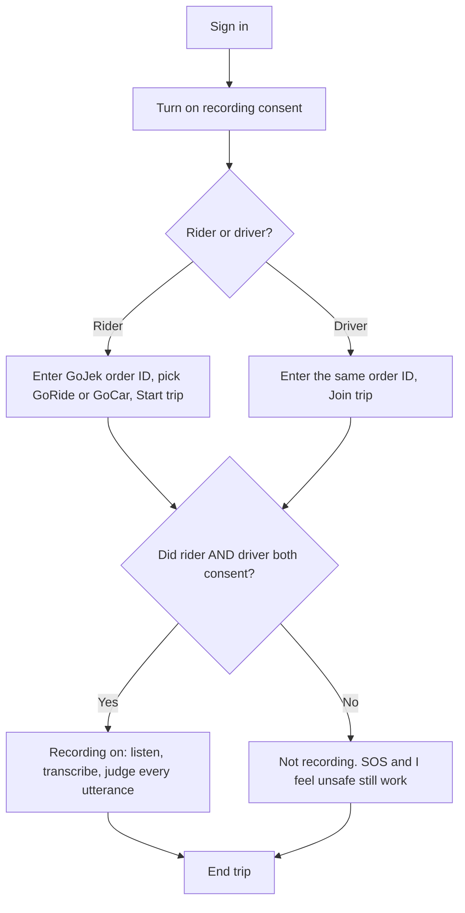
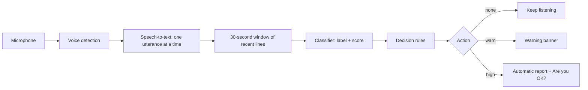

# GoSafe mobile app: technical and logic guide

The mobile app is the core of GoSafe. It listens during the trip, turns speech into text, judges the conversation, and responds, all on the phone. The backend only receives the reports the phone sends and passes them to customer service.

This guide describes the app as it is built today. The product decisions behind it are in [contracts/ARCHITECTURE.md](../contracts/ARCHITECTURE.md), section "On-device listening".

## Status

| Part | State |
|---|---|
| Login, trip by GoJek order ID, consent | Built, runs against the local Firebase emulators |
| Decision engine (window, classifier, rules) | Built and tested |
| Warning, automatic report, "Are you OK?", SOS, "I feel unsafe" | Built and tested |
| Answering backend check-ins | Built (reads Firestore directly; push notifications not yet) |
| Speech input (microphone, voice detection, Whisper) | **Mocked**: a scripted conversation |
| Classifier | **Stand-in**: an Indonesian keyword filter until IndoBERT is ready |
| Microphone foreground service, encrypted 7-day audio, clip upload | Not built |
| Push notifications, audio requests from agents | Not built |

## How one trip works



- **The order ID is the trip ID.** The rider's app creates the trip with it; the driver's app joins with the same ID. The app never asks for location permission and never sends GPS or route data, because GoJek already holds that.
- **Consent is checked against the backend's record of the trip,** not just this phone's switch. If either person said no, the microphone stream is never opened.
- **Both phones run the same logic on their own.** They hear the same conversation, so both reach the same verdict and both show their own warning or "Are you OK?". Neither phone waits for the other or for the backend.

## The listening pipeline



Today the first three boxes are replaced by `mock_listener.dart`, which plays a scripted Indonesian conversation one line every 3 seconds. Everything from the window onwards is the real logic.

### Step 1: the 30-second window

Every finished utterance is added to a list with the time it was heard. Lines older than 30 seconds are dropped. The classifier always judges the whole window, not just the last line, so a remark is read in context. When the phone sends a report, this window is the evidence: each line's `start` and `end` are seconds from the first line in the window.

### Step 2: the classifier (keyword stand-in)

`KeywordClassifier` looks for Indonesian phrases, including Jakarta slang, in three groups:

| Label | Example phrases |
|---|---|
| `threat` | bunuh, pukul, hajar, pisau, culik, "diem aja", "jangan banyak tanya", "tahu rumah", "jangan lapor" |
| `sexual_harassment` | "cantik banget", seksi, pegang, cium, raba, "ke hotel", "mampir ke tempat", "tempat saya", "buka baju" |
| `uncomfortable` | "tinggal sendiri", sendirian, "punya pacar", "rumahnya di mana", "minta nomor", "umur berapa", sayang |

How it scores the window:

- It counts every matched **phrase** in the window, per label. Two phrases in one sentence count as two.
- The window gets the most severe label that has any match, in the order threat, then sexual harassment, then uncomfortable. No match means `normal`.
- Score = 0.5 + 0.15 × (number of phrases for that label), capped at 0.95. A `normal` window scores 0.5.
- Each line is marked `flagged` if it contains any phrase. The dashboard highlights flagged lines.

The phrase list is a high-recall first pass, so expect false alarms. The backend has an identical copy (`backend/app/services/classify.py`) for reports that arrive without a label.

### Step 3: the decision rules

`SafetyEngine` turns each verdict into one action. It checks these in order:

1. **Already reported on this trip?** Then do nothing more. One automatic report per trip is enough, since a person at customer service now has the case. Warnings stop too.
2. **High:** the label is `threat` or `sexual_harassment` and the score is at least **0.8**. Send an automatic report and ask "Are you OK?".
3. **Warning:** any label other than `normal`, a score of at least **0.6**, and no warning shown in the last **10 minutes**. Show the warning banner.
4. Otherwise, nothing.

| Settings | Value today | Who sets the real value |
|---|---|---|
| Warning threshold | 0.6 | Modelling team, from their test set |
| High threshold | 0.8 | Modelling team, from their test set |
| Window | 30 s | Fixed by the design |
| Warning cooldown | 10 min | Fixed by the design |

What that means with the keyword stand-in:

| Heard within 30 s | Score | Result |
|---|---|---|
| Ordinary talk | 0.50 | Nothing |
| One uncomfortable phrase ("Udah punya pacar belum?") | 0.65 | Warning |
| One harassment phrase | 0.65 | Warning only |
| Two harassment phrases ("Cantik banget sih, nanti mampir ke tempat saya") | 0.80 | Automatic report |
| One threat phrase | 0.65 | Warning |
| Two threat phrases | 0.80 | Automatic report |

### The demo conversation, step by step

`mock_listener.dart` plays these lines 3 seconds apart:

| Time | Line | What happens |
|---|---|---|
| 3 s | Selamat sore Mbak, sesuai aplikasi ya, ke Senayan. | Nothing |
| 6 s | Iya Pak, lewat Sudirman aja. | Nothing |
| 9 s | Mbak kerja di mana? Udah punya pacar belum? | **Warning** (uncomfortable, 0.65) |
| 12 s | Hmm, Pak, fokus nyetir aja ya. | Nothing |
| 15 s | Tinggal sendiri ya? Rumahnya di mana? | Nothing (warning cooldown) |
| 18 s | Cantik banget sih, nanti mampir ke tempat saya dulu. | **Automatic report + "Are you OK?"** (sexual harassment, 0.80) |
| 21 s | Pak, saya mau turun di depan aja. | Nothing (already reported) |

## Responses on screen

| Event | Rider | GoCar driver | GoRide driver |
|---|---|---|---|
| Warning | Banner: "This conversation seems uncomfortable. Please keep it respectful. If you feel unsafe, tell us." with Dismiss and Report | Same banner | Same banner |
| Automatic report | Report sent in the background, then an "Are you OK?" dialog | Same dialog | A banner, "Answer when you have stopped", that never blocks the screen |
| "I need help" on that prompt | Sends an SOS report | Same | Same |
| Report (on the warning) or "I feel unsafe" | Sends a `manual_unsafe` report | Same | Same |
| SOS button | Sends an `sos` report | Same | Same |
| Backend check-in arrives | "Are you OK?" dialog; the answer goes to the backend | Same dialog | Banner |

The neutral warning wording goes to both people on purpose: it doesn't accuse anyone, so it doesn't single out or provoke the driver. A GoRide driver is on a motorbike and can't tap, so nothing on their screen ever demands an answer. The SOS and "I feel unsafe" buttons are on screen for the whole trip and never wait for the model.

## What the phone sends to the backend

Every report is one `POST /incidents`, then `POST /incidents/{id}/finalize`. The phone attaches its own evidence:

```json
{
  "tripId": "GR-E2E-1",
  "trigger": "auto",
  "windowStart": "2026-11-26T08:59:12Z",
  "windowEnd": "2026-11-26T08:59:34Z",
  "deviceTranscript": [
    {"start": 6, "end": 10, "text": "Mbak kerja di mana? Udah punya pacar belum?"},
    {"start": 15, "end": 19, "text": "Cantik banget sih, nanti mampir ke tempat saya dulu."}
  ],
  "deviceLabel": "sexual_harassment",
  "deviceScore": 0.8
}
```

| `trigger` | Sent when | What the backend does |
|---|---|---|
| `auto` | The engine reached "high" | Escalates straight to customer service |
| `sos` | SOS button, or "I need help" | Escalates if the label is harmful or there's no label; otherwise asks both people "Are you OK?" through a check-in |
| `manual_unsafe` | "I feel unsafe", or Report on a warning | Escalates if the label is harmful; otherwise asks both people "Are you OK?" through a check-in |

The backend uses the phone's transcript, label and score as given; it runs no models of its own. Audio isn't attached yet, since input is mocked. The upload URL the backend returns is ignored for now.

Other calls the app makes: `POST /me/consent`, `POST /trips` (rider only, with `orderId` and `mode`), `POST /trips/{id}/end`, and `POST /checkins/{id}/reply`. It reads two things straight from Firestore: the trip's mode and consent, and its own unanswered check-ins.

## Privacy rules the code follows

- Nothing is recorded unless rider **and** driver consented to this trip.
- No location: no permission, no GPS, no route.
- The phone only sends a report on a button press or at "high".
- A person at customer service reviews every case. The app never warns, suspends or bans a driver on its record.
- Not built yet: storing audio encrypted on the phone for 7 days, with no playback or export in the app.

## Code map

| File | Job |
|---|---|
| `lib/main.dart` | Starts Firebase (pointed at the emulators), login gate, builds the trip screen with the real API and Firestore |
| `lib/features/auth/login_screen.dart` | Email and password sign-in |
| `lib/features/trip/trip_screen.dart` | The trip: consent, order ID, listening, and every response above |
| `lib/features/safety/are_you_ok.dart` | The "Are you OK?" dialog, and the non-blocking banner for GoRide drivers |
| `lib/engine/safety_engine.dart` | The 30-second window and the decision rules |
| `lib/engine/classifier.dart` | The `Classifier` interface and the keyword stand-in |
| `lib/services/api.dart` | Calls to the backend, with the user's login token |
| `lib/services/mock_listener.dart` | The scripted conversation standing in for microphone and Whisper |

## Swapping in the real models

Two interfaces keep the mocks replaceable without touching the screens or the engine:

- **Speech:** `TripScreen.listen` is a `Stream<String> Function()`, one finished utterance per item. Replace `scriptedListener` with a sherpa_onnx listener: Silero voice detection, then Whisper on each utterance.
- **Classifier:** `Classifier.classify(List<String> lines)` returns a label, a score and per-line flags. Replace `KeywordClassifier` with IndoBERT running in ONNX Runtime. That also needs its tokenizer ported to Dart, or a model export that includes it.

Then set the real thresholds in `SafetyEngine`.

## Tests

`flutter test` runs 14 tests with no backend needed.

| File | Covers |
|---|---|
| `test/engine_test.dart` | Classifier labels, flags and scores. Engine: ordinary talk, warning and cooldown, high once per trip, the 30-second window, a threat below the high threshold |
| `test/trip_screen_test.dart` | Consent gate; no recording without both consents while SOS still works; warning and Report; automatic report and "Are you OK?" with need help sending SOS; GoRide driver banner; GoCar driver dialog; a backend check-in answered once |

## Running it

Start the emulators, seed data and backend as described in the root [CLAUDE.md](../CLAUDE.md), under "Run everything locally". Then:

| Target | Command, from `mobile/` |
|---|---|
| Browser preview | `flutter run -d chrome` |
| Android emulator | `flutter run` (the app reaches this Mac at `10.0.2.2`) |
| Real phone, same Wi-Fi as the Mac | `flutter run --dart-define=API_URL=http://<your Mac's IP>:8000 --dart-define=EMULATOR_HOST=<your Mac's IP>`. The emulators and backend only listen on this Mac by default: add `"host": "0.0.0.0"` to the auth and firestore entries in `firebase/firebase.json`, and start the backend with `--host 0.0.0.0` |

Test accounts are `rider1@gosafe.test`, `driver1@gosafe.test` and so on, with the password from `SEED_PASSWORD` in `backend/.env.example`. To test the driver side, sign in as `driver1` on a second device or tab, and join with the same order ID right after the rider starts the trip.
